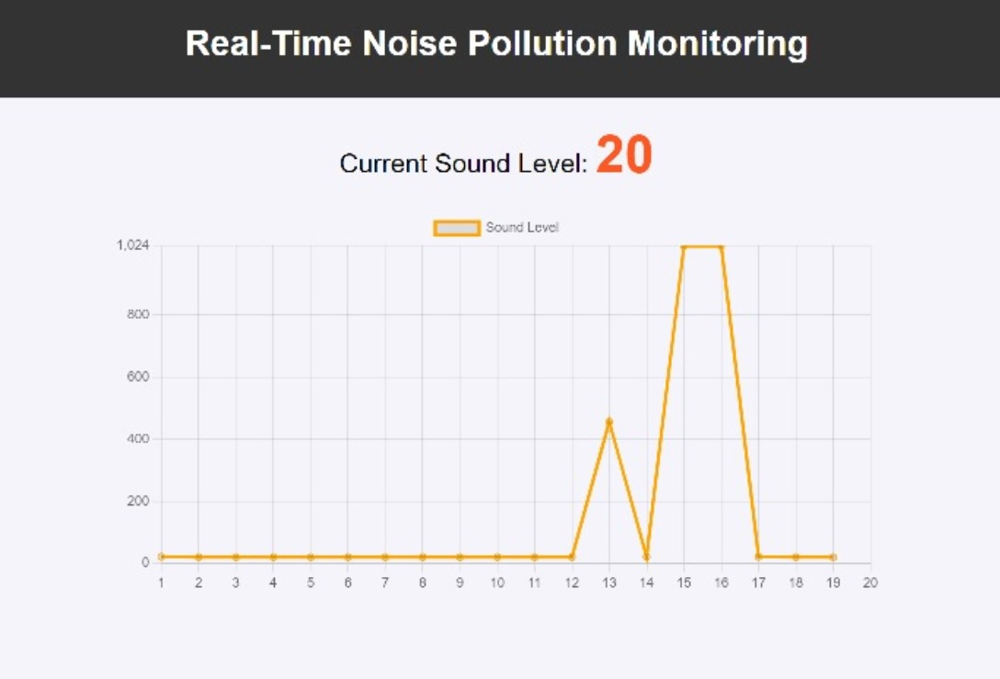
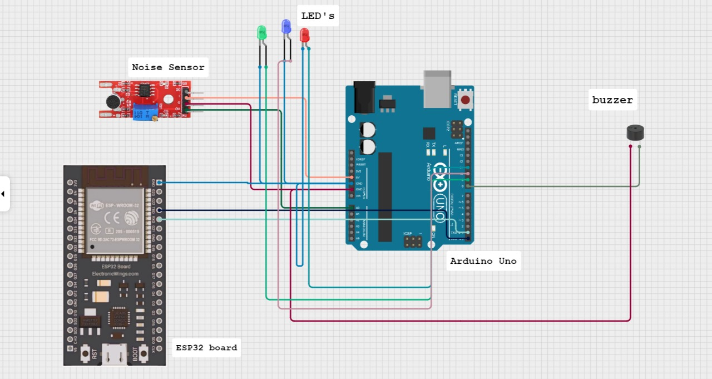
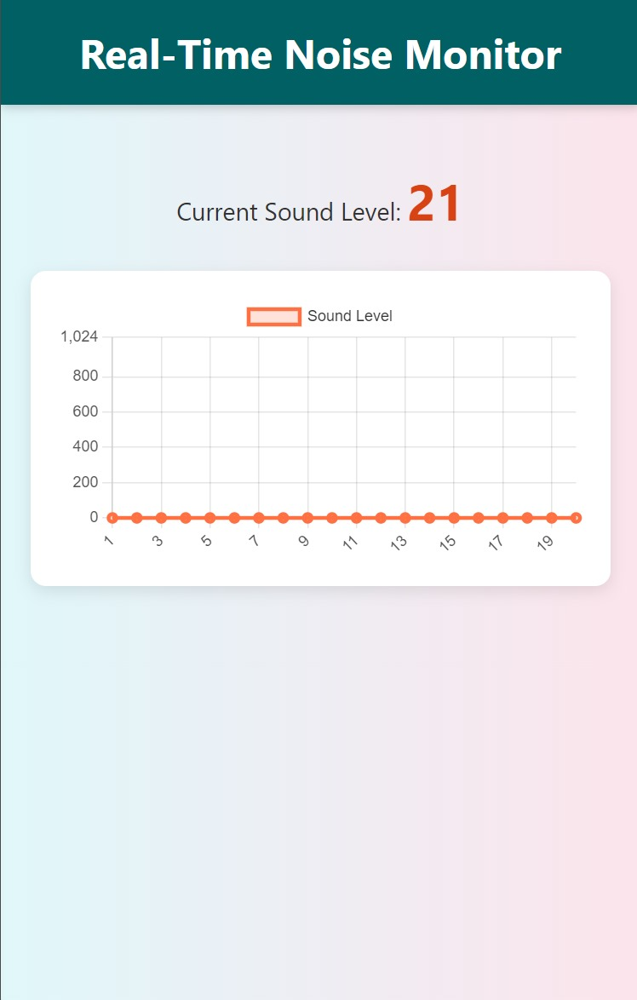
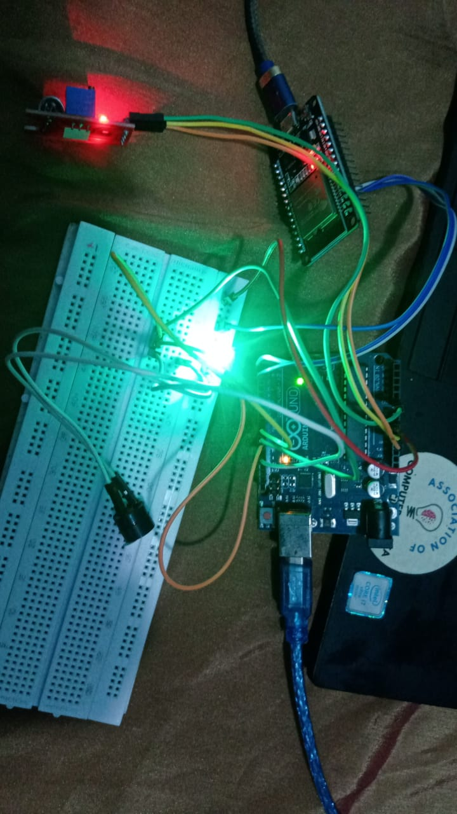
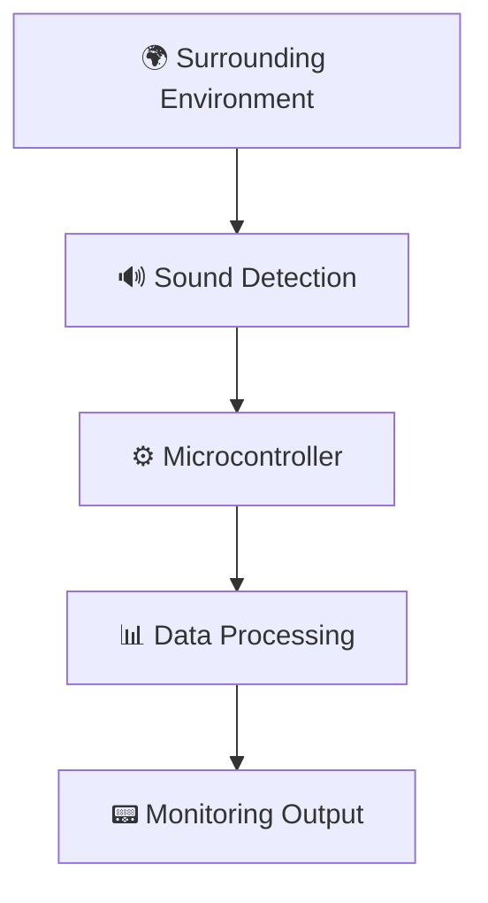

 <div align="center">

# 🔊 Noise Pollution Monitoring System

### Real-Time Noise Detection & Monitoring Using Arduino

An embedded systems project designed to detect and monitor environmental noise levels using Arduino-based microcontroller platforms.

<br>


</div>

---

## 📖 About the Project

Noise pollution is an environmental concern that can negatively affect people's health, comfort, and quality of life.

The **Noise Pollution Monitoring System** is an Arduino-based project developed to detect and monitor surrounding noise levels in real time.

The project explores how microcontrollers and sound-sensing hardware can be used to collect environmental noise information and present it through a monitoring system.

It includes two hardware implementations:

- **Arduino Uno** — A microcontroller-based implementation.
- **ESP32** — An alternative implementation using the ESP32 platform.

By combining electronics and embedded programming, this project demonstrates a practical application of technology to an environmental monitoring problem.

## 🎯 Project Objectives

- Detect surrounding environmental noise.
- Monitor noise conditions in real time.
- Interface sound-sensing hardware with microcontrollers.
- Process sensor readings using embedded programming.
- Explore different microcontroller platforms.
- Demonstrate a practical environmental monitoring application.

## ✨ Key Features

- 🔊 **Noise Detection** — Detect surrounding environmental sound.
- 📊 **Noise Monitoring** — Observe noise-related readings through the monitoring system.
- ⚙️ **Embedded Programming** — Process sensor information using microcontroller-based code.
- 🔌 **Hardware Integration** — Combine electronic components with embedded software.
- 🔄 **Multiple Platforms** — Includes Arduino Uno and ESP32 implementations.
- 🌍 **Environmental Application** — Demonstrates technology applied to noise pollution awareness.

## 🖼️ Project Gallery

A look at the hardware setup and project implementation.

<div align="center">

### 📸 Project Setup



<br><br>



<br><br>



<br><br>



</div>

---

## 🛠️ Hardware & Technology

| Technology | Purpose |
|---|---|
| Arduino Uno | Microcontroller platform |
| ESP32 | Alternative microcontroller platform |
| Embedded C/C++ | Microcontroller programming |
| Arduino IDE | Development and code uploading |
| Sound Sensor | Environmental sound detection |

*The exact sensor model, additional electronic components, and libraries depend on the individual hardware implementation.*

## 🏗️ System Architecture

The general monitoring workflow can be represented as follows:



### How It Works

1. **Sound Detection:** The connected sensing hardware detects surrounding sound.
2. **Data Collection:** The microcontroller receives sensor readings.
3. **Data Processing:** The embedded program processes the collected readings.
4. **Monitoring:** The system presents the resulting noise-related information.

## 📂 Project Structure

```text
Noise-Pollution-Monitoring-System---Arduino/
│
├── ESP32/
│   └── ESP32 implementation
│
├── uno_board/
│   └── Arduino Uno implementation
│
├── img/
│   ├── ss.jpg
│   ├── ss1.jpg
│   ├── ss2.jpg
│   └── ss3.jpg
│
├── .gitattributes
└── README.md
```

| Directory | Description |
|---|---|
| `ESP32/` | ESP32 implementation files |
| `uno_board/` | Arduino Uno implementation files |
| `img/` | Project photographs and visual resources |

## ⚙️ Getting Started

### Prerequisites

- Arduino IDE.
- Arduino Uno or compatible ESP32 development board.
- Required sound-sensing hardware.
- USB cable compatible with the selected board.
- Necessary electronic components and jumper wires.

### 1. Clone the Repository

```bash
git clone https://github.com/sapuCodes/Noise-Pollution-Monitoring-System---Arduino.git
```

### 2. Navigate to the Project

```bash
cd Noise-Pollution-Monitoring-System---Arduino
```

### 3. Select an Implementation

Choose the appropriate directory:

- `ESP32/` for the ESP32 implementation.
- `uno_board/` for the Arduino Uno implementation.

### 4. Open in Arduino IDE

Open the corresponding source file in Arduino IDE and configure the appropriate board and communication port.

### 5. Upload and Test

Connect the hardware, compile the program, and upload it to the selected microcontroller.

Once uploaded, power the system and observe its noise monitoring output.

*Refer to the individual implementation files for the exact wiring, pin configuration, and hardware requirements.*

---

## 🌍 Potential Applications

Noise monitoring technology can be useful in:

- Residential areas.
- Educational institutions.
- Libraries and study environments.
- Hospitals and healthcare facilities.
- Commercial buildings.
- Industrial environments.
- Urban and traffic-affected areas.

## 🚀 Future Improvements

- Calibrated sound-level measurements in decibels (dB).
- Configurable noise threshold detection.
- Visual alerts for excessive noise levels.
- Wireless monitoring using ESP32.
- Historical noise data collection.
- Web-based monitoring dashboard.
- Remote notifications and alerts.

## 🤝 Contributing

Suggestions and improvements are welcome.

1. Fork the repository.
2. Create a new branch.
3. Make your changes.
4. Test your implementation.
5. Submit a pull request.

## 👨‍💻 Author

**Sapumal Prasanna**

Software Engineering Undergraduate

- GitHub: [@sapuCodes](https://github.com/sapuCodes)
- LinkedIn: [Sapumal Prasanna](https://www.linkedin.com/in/sapumalprasanna/)

---

<div align="center">

### 🌍 Building Technology for a Quieter Environment

⭐ If you find this project interesting, consider giving the repository a star!

</div>
